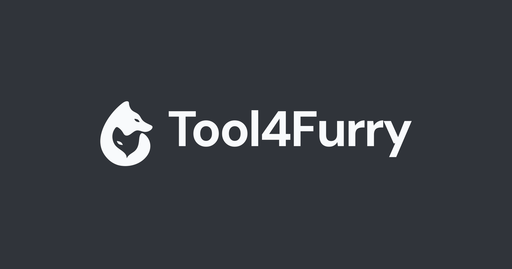

# Tool4Furry

面向 Furry 创作者的开源浏览器工具箱。使用 Astro 静态站点、React 按需交互、TypeScript 与 StyleX，工具在浏览器本地处理用户文件；当前没有后端、数据库或用户系统。



## 当前工具

**Image Converter** 支持 PNG、JPEG、WebP、AVIF 静态图片互转，批量与文件夹导入、图片预览、逐项下载和 ZIP 打包；默认清理常见来源隐私元数据，并提供受限的作者与版权字段保留。能力与限制见 [当前模块说明](docs/image-converter-implementation.md)。

**Image Resize & Crop** 支持自由/固定比例裁剪、精确尺寸与百分比、可缩放平移的裁剪工作区，以及批量缩放、文件夹导入、预览对比、独立下载和 ZIP；支持 PNG/JPEG/WebP/受限静态 AVIF 输入，输出 PNG/JPEG/WebP。能力、Beta 资格与未测范围见 [当前模块说明](docs/image-resize-crop-implementation.md)。

两款工具均在源码层面 **Published**。CN/Global 均可构建完整双语静态站点，**两个地区均未线上部署**。Published 和构建就绪不代表已对公网提供服务。

## 技术与架构

Astro 输出页面正文和 SEO，React 只负责工具等必要交互，StyleX 提取静态样式。CN/Global 独立构建，每个地区同时支持中文和英文；Registry 统一控制工具可用性。结构与依赖方向见 [.agents/architecture.md](.agents/architecture.md)。

## 快速开始

Node.js 版本范围为 `^22.12.0 || ^24.0.0 || >=26.0.0`，pnpm 固定 **12.8.1**，以 [package.json](package.json) 为准。可先用 `npm install --global pnpm@12.8.1` 安装 pnpm。

```powershell
git clone --branch develop https://github.com/librecosta/tool4furry.git
cd tool4furry
pnpm install --frozen-lockfile
pnpm dev
```

不需要数据库、云账户、密钥或 `.env`。一次启动两个本地服务：

| 地区 | 默认语言 | 另一语言 |
| --- | --- | --- |
| CN | 中文 `http://127.0.0.1:4321/` | English `http://127.0.0.1:4321/en/` |
| Global | English `http://127.0.0.1:4322/` | 中文 `http://127.0.0.1:4322/zh/` |

相同前缀适用于 `/tools/`、`/tools/image-converter/`、`/tools/image-resize-crop/` 和信息页。语言切换留在当前来源；端口固定，占用会报错，不自动换端口。同仓库旧服务可用 `pnpm dev stop` 关闭后重新启动；不要为调试占用修改端口配置，也不要终止归属不明的进程。Ctrl+C 或 `pnpm dev stop` 同时停止两端。具体约束见 [开发工作流](.agents/playbook.md#本地服务与固定端口)。Lab 与显式目录夹具仅供 DEV，不进入生产。

## 测试与构建

日常遵循 [L1/L2/L3 政策](AGENTS.md#mvp-beta-release-policy-2026-10-10)，只验证改动涉及的范围。需要完整工程验证时，先停止两端 DEV，再顺序执行：

```powershell
pnpm check
pnpm test
pnpm build:cn
pnpm build:global
```

`check` 为 Astro/TypeScript 检查，`test` 为 Vitest；两地区构建分别输出 `dist/cn` / `dist/global`，并运行现有静态产物守卫。`pnpm build` 是 CN 别名。可用 `pnpm preview` / `pnpm preview:global` 预览产物，也可用普通 HTTP Server 托管输出目录。

详细命令、定向验证与分支流程见 [.agents/playbook.md](.agents/playbook.md)。现有 GitHub Actions 执行 CI，没有自动部署。

## 仓库结构

| 目录 | 职责 |
| --- | --- |
| `src/pages/`、`src/layouts/` | 静态路由、页面外壳和 SEO |
| `src/components/`、`src/site/` | 静态 UI、内容及工具发现投影 |
| `src/config/`、`src/i18n/` | 地区与语言配置 |
| `src/tools/` | Registry、懒加载与独立工具业务 |
| `src/ui/`、`src/workbench/` | 受控原语与可选工作区布局 |
| `src/styles/`、`src/visuals/` | StyleX、受控页面增强与 Wavefield |
| `src/lab/` | DEV-only 演示 |
| `tests/`、`scripts/` | 行为测试、隔离夹具与构建审计 |
| `public/` | 品牌、正式素材和静态授权文件 |

## 文档与贡献

从 [AGENTS.md](AGENTS.md) 和 [文档索引](docs/README.md) 进入相关模块；稳定约束见 [contracts](contracts/)，架构取舍见 [ADRs](docs/decisions/README.md)，重要变更见 [CHANGELOG](CHANGELOG.md)。历史设计、研究与验收数据均从索引可达。

开发使用 `develop`，经 PR 集成到 `pre-master`，再经 PR 合入 `master`；不要把日常提交当作部署授权。贡献前检查现有实现、测试和对应契约，保持修改范围清晰。

## 许可证

项目自有代码采用 [BSD-3-Clause](LICENSE)。第三方组件与素材按各自授权：自托管字体的 [DM Sans OFL](public/licenses/dm-sans-OFL.txt) / [Noto Sans SC OFL](public/licenses/noto-sans-sc-OFL.txt)、[AVIF LICENSE/NOTICE](src/tools/image/avif.NOTICE.txt)、[裁剪组件 ISC/修改声明](src/tools/image-resize-crop/crop.NOTICE.txt)、[Wavefield NOTICE](src/visuals/wavefield/NOTICE.md) 和 [滚动参考许可](public/licenses/gopher-atlas.txt)；品牌与正式素材来源见 [视觉说明](docs/visual-foundation.md)。
